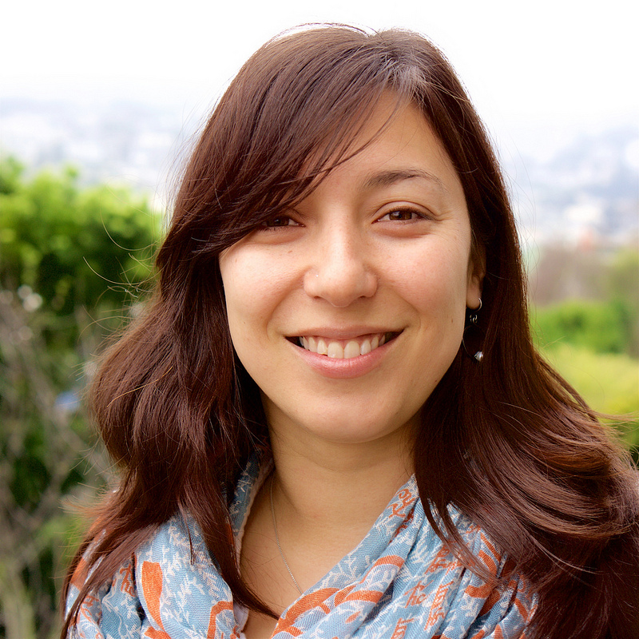

I'm an Assistant Professor in the [School of Computing](http://www.cs.utah.edu/) at the [University of Utah](https://www.utah.edu/).

I work in the areas of social computing, crisis informatics, and human-centered data science. My background in Sociology and Computer Science informs my focus on studying online coordination, collective problem-solving, and information flows during disruption events such as disasters arising from natural hazards, epidemics, and political crises. My most recent work analyzes collective sensemaking, coordination, and information flows in instances of mis/disinformation, conspiracy theories, and state-sponsored information operations.

I completed my PhD in [Computer Science](https://www.colorado.edu/cs/) at the [University of Colorado Boulder](http://colorado.edu) in [Human Centered Computing](http://hcc.colorado.edu) under the advisement of Professor [Leysia Palen](http://cmci.colorado.edu/~palen/). Then I spent a year and a half as an Assistant Professor of [Computer Science](https://www.cs.unm.edu/) at [University of New Mexico](https://www.unm.edu/).

Before developing my interdisciplinary focus, I studied Sociology at [University of Illinois at Urbana-Champaign](http://illinois.edu/) and worked as STEM education researcher at [Ethnography & Evaluation Research](http://www.colorado.edu/eer/).

This is my personal site, highlihgting my reseach as a graduate student. For my current research at [University of Utah](https://www.utah.edu/), please take a look at the [MESA lab website](https://kogan-research.github.io/mesa-website/publications/).

